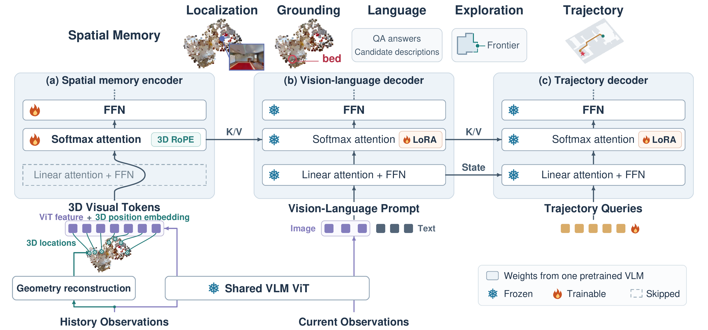
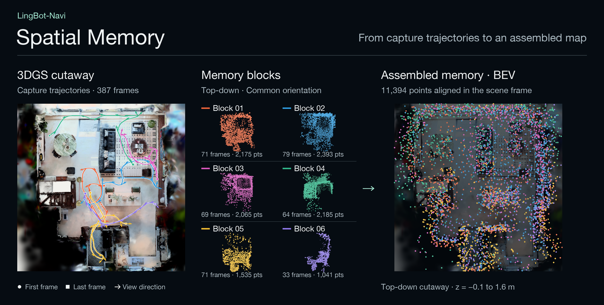
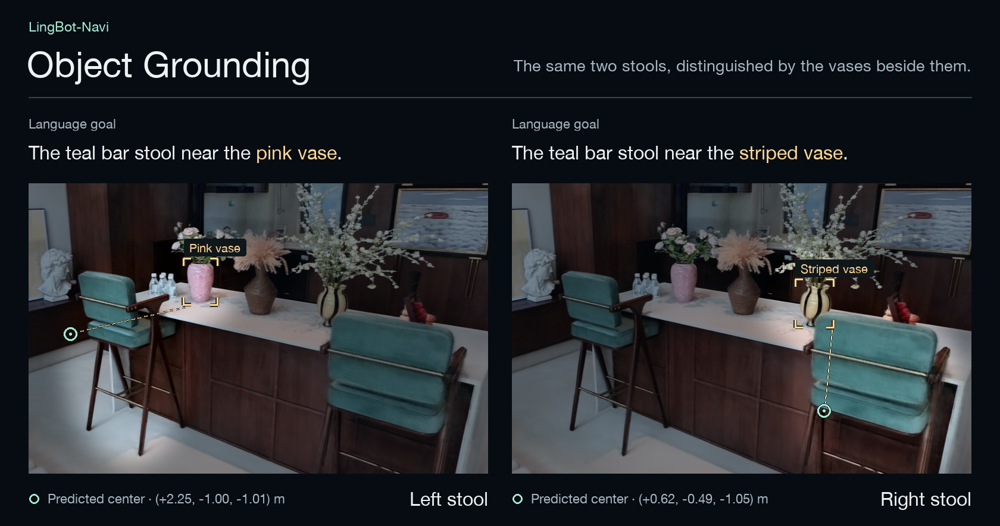
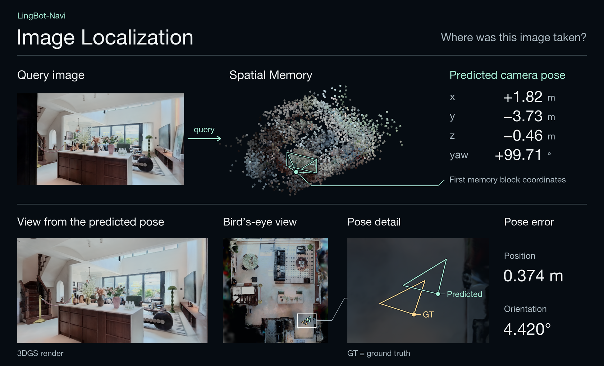
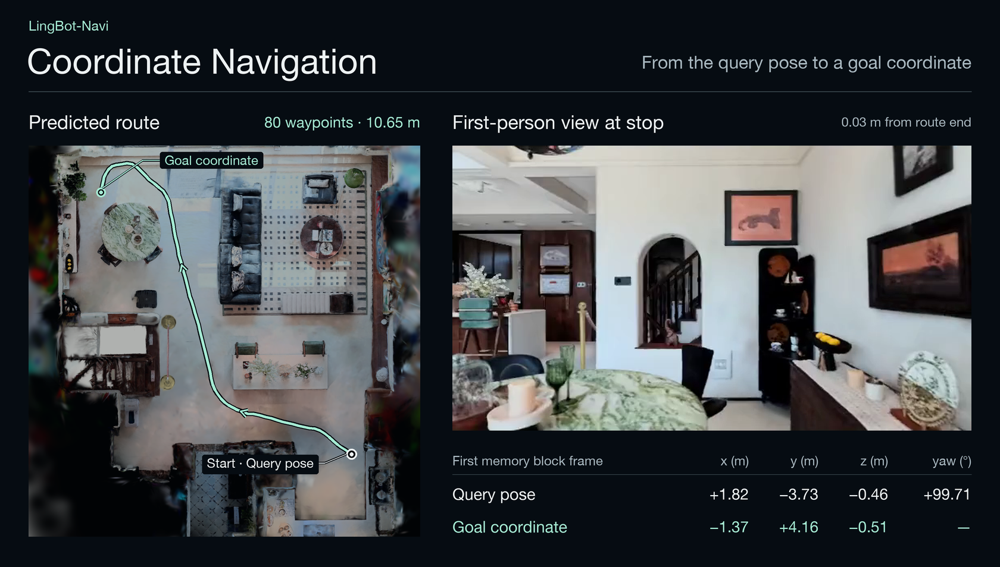
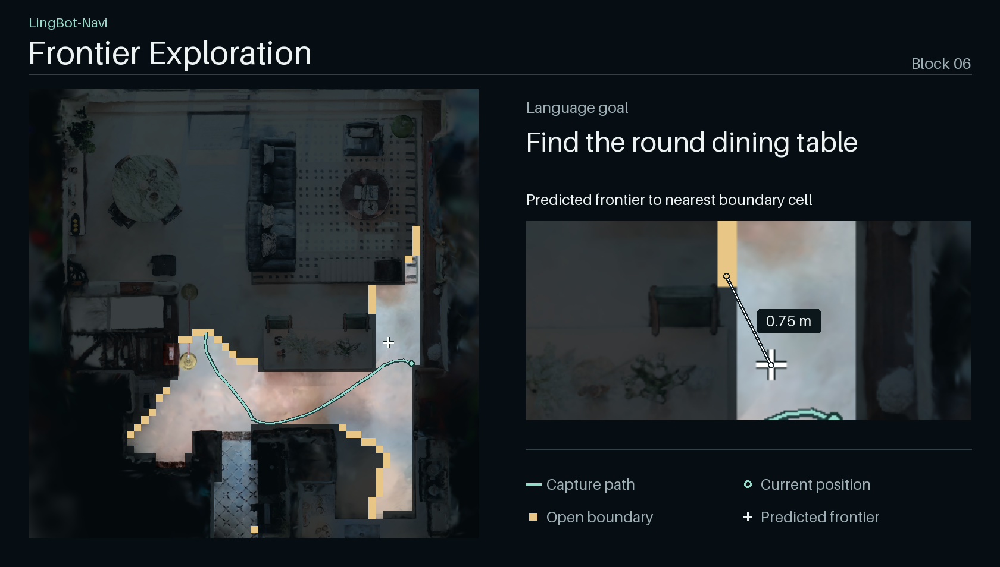

<div align="center">

<h1>LingBot-Navi: Scene‑aware Navigation with Spatial Memory</h1>

<p><strong>English</strong> | <a href="README_zh-CN.md">简体中文</a></p>

<p><strong>Spatial Memory · Object Grounding · Image Localization · Coordinate Navigation</strong></p>

<p><a href="https://github.com/Robbyant/lingbot-navi"></a> <a href="#quick-start"></a> <a href="#installation"></a> <a href="https://huggingface.co/robbyant/lingbot-navi"></a> <a href="https://www.modelscope.cn/models/Robbyant/lingbot-navi"></a> <a href="https://huggingface.co/datasets/robbyant/LingBot-Navi"></a> <a href="https://www.modelscope.cn/datasets/Robbyant/LingBot-Navi"></a></p>

</div>

---

### 🧭 Meet LingBot-Navi!

**LingBot-Navi** addresses a central challenge in continuous robot navigation: using earlier observations to understand new requests and reach targets beyond the current view. It connects historical scene evidence, the current image, and language through **Spatial Memory**.

- **Reusable 3D memory:** anchors visual features to reconstructed surfaces and organizes them into compact spatial tokens across local reconstruction blocks.
- **Unified scene understanding and navigation:** combines a spatial memory encoder, a vision-language decoder, and a trajectory decoder for object grounding, image localization, spatial question answering, and 3D route prediction.
- **Workplace data and evaluation:** introduces a dataset of reconstructed real-world workplaces and a sequential-task benchmark for studying memory reuse across successive navigation goals.

<p align="center">
  
</p>

---

## 📑 Table of Contents

<details>
<summary>Click to expand</summary>

- [News](#news)
- [Installation](#installation)
- [Model Download](#model-download)
- [Dataset](#dataset)
- [Quick Start](#quick-start)
  - [Build Spatial Memory](#build-spatial-memory)
  - [Object Grounding](#object-grounding)
  - [Image Localization](#image-localization)
  - [Coordinate Navigation](#coordinate-navigation)
  - [Frontier Exploration](#frontier-exploration)
  - [Local Route Execution](#local-route-execution)
- [Benchmark](#benchmark)
- [License](#license)
- [Citation](#citation)
- [Acknowledgments](#acknowledgments)

</details>

---

<a id="news"></a>

## 📰 News

- **2026-11-26** — First public release of LingBot-Navi, including the inference code, model weights, and dataset.

<a id="installation"></a>

## ⚙️ Installation

**Requirements:** Linux x86_64, Python 3.10+, and an NVIDIA GPU. Rendering requires the CUDA 12.8 toolkit and a C++ compiler.

~~~bash
git clone https://github.com/Robbyant/lingbot-navi.git LingBot-Navi
cd LingBot-Navi
conda create -n lingbot-navi -c conda-forge python=3.10 git -y
conda activate lingbot-navi
python install.py
~~~

`python install.py` also installs the pinned `lingbot-map` package used by the spatial-memory example and closed-loop evaluation.

<a id="model-download"></a>
<a id="model-files"></a>

## 📦 Model Download

| Model Name | Huggingface Repository | ModelScope Repository | Description |
| --- | --- | --- | --- |
| LingBot-Navi | [robbyant/lingbot-navi](https://huggingface.co/robbyant/lingbot-navi) | [Robbyant/lingbot-navi](https://www.modelscope.cn/models/Robbyant/lingbot-navi) | Spatial memory model for object grounding, image localization, and coordinate navigation. |

<a id="dataset"></a>
<a id="dataset-download"></a>

## 🌍 Dataset

| Dataset Name | Huggingface Repository | ModelScope Repository | Description |
| --- | --- | --- | --- |
| LingBot-Navi | [robbyant/LingBot-Navi](https://huggingface.co/datasets/robbyant/LingBot-Navi) | [Robbyant/LingBot-Navi](https://www.modelscope.cn/datasets/Robbyant/LingBot-Navi) | 511 reconstructed real-world scenes. |
| LingBot-Navi-Test | [robbyant/LingBot-Navi-Test](https://huggingface.co/datasets/robbyant/LingBot-Navi-Test) | [Robbyant/LingBot-Navi-Test](https://www.modelscope.cn/datasets/Robbyant/LingBot-Navi-Test) | 36 test scenes included in the full LingBot-Navi dataset. |

### 3DGS Rendering Example

[This example](examples/render_3dgs.py) loads a 3DGS PLY scene and renders an RGB image from the specified camera pose for display:

~~~bash
python -m examples.render_3dgs \
  --ply /path/to/scene.ply \
  --pose 0 0 1.5 0 0 0
~~~

`--pose` is `x y z roll pitch yaw`, in meters and degrees. It is optional and defaults to `0 0 1.5 0 0 0`.

<a id="quick-start"></a>

## 🚀 Quick Start

Run commands from the **repository root**. Download LingBot-Navi weights and [LingBot-Map weights](https://huggingface.co/robbyant/lingbot-map). Copy or symlink data and complete checkpoint directories into the layout below; prepare only the assets needed for the features you run. The 3DGS asset used for testing is `demo.ply` from LingBot-Navi-Test, available on [Hugging Face](https://huggingface.co/datasets/robbyant/LingBot-Navi-Test) or [ModelScope](https://www.modelscope.cn/datasets/Robbyant/LingBot-Navi-Test).

Place the entire downloaded `lingbot-navi` folder under `ckpts/`, keeping its contents together.

```text
datasets/
  goat/hm3d/v1/             # GOAT task splits
  goat/scene_datasets/      # HM3D scene assets
  lingbot/                  # lingbot-navi evaluation release (manifest.json)
ckpts/
  lingbot-navi/
    navigation_transformer/
    local_planner/checkpoint.pt
  lingbot-map/
    lingbot-map.pt          # spatial-memory demo and lingbot-map1.0 evaluation
```

Example symlinks (replace `/path/to/...`; alternatively use `cp -a SOURCE DESTINATION` to copy to the same locations):

```bash
mkdir -p datasets/goat ckpts/lingbot-map
ln -s /path/to/lingbot-navi ckpts/lingbot-navi
ln -s /path/to/lingbot-map.pt ckpts/lingbot-map/lingbot-map.pt
```

Set `LINGBOT_GS_ASSET` to the path of the downloaded `demo.ply` file.

```bash
export LINGBOT_GS_ASSET=/path/to/demo.ply
```

- **Demo 1:** Build Spatial Memory by rendering a 3DGS scene along six saved camera trajectories.
- **Demos 2–4:** Run object grounding, image localization, and coordinate navigation using the provided `memory.npz` or your own memory. Demo 1 is optional.
- **Demo 5:** Follow the predicted route with the local planner and save an execution video.

The bundled memory was rebuilt from the six recorded trajectory segments (`segment_01`–`segment_06`), with 11,394 points after preprocessing. Each block retains its own local coordinate frame; predictions use the first-block frame.

The commands below save predictions (`result.json`) and visualizations under `outputs/demo/`. Use a new output directory when repeating a demo.

<a id="build-spatial-memory"></a>

### 1. Build Spatial Memory

Replay the camera positions, orientations, intrinsics and block assignments in `trajectory.json` to render RGB observations from the 3DGS scene. LingBot-Map reconstructs each block, and Qwen3.5-4B provides its visual features.

The example contains **387 capture frames in six trajectory segments**, with **71, 79, 69, 64, 71 and 33 frames** respectively. Colors link the capture trajectories (left) to their memory blocks (center). On the right, the six blocks are transformed into scene coordinates and projected onto the same 3DGS cutaway, at the same scale and orientation. The cutaway shows points from −0.1 to 1.6 m above the floor. Arrows show camera viewing directions. Circles and squares mark each segment's first and last frames.



~~~bash
python -m examples.build_spatial_memory \
  --gs-asset "$LINGBOT_GS_ASSET" \
  --output-dir "outputs/demo/spatial_memory"
~~~

The generated `memory.npz` can be used in Demos 2–4. Set `--memory` to this file and `--scene` to the `scene.json` in the same output directory.

<a id="object-grounding"></a>

### 2. Object Grounding

Distinguish similar targets using surrounding objects: locate the teal bar chair beside the pink vase and the one beside the striped vase.



Replace `grounding question` with a description of the target object.

~~~bash
python -m examples.demo \
  --task grounding --question "grounding question" \
  --gs-asset "$LINGBOT_GS_ASSET" \
  --output-dir "outputs/demo/grounding"
~~~

<a id="image-localization"></a>

### 3. Image Localization

Use `query.png` to query Spatial Memory for the camera position and orientation. The example image looks northwest from the lower-right corridor in the BEV; its camera parameters are in `scene.json`.

<details>
<summary>Query image preparation</summary>

The example is rendered at 1080×640 with a 90° horizontal FOV, resized with Lanczos to a 640-pixel long edge, and center-cropped to 640×352 for 32-pixel alignment. Camera intrinsics are adjusted for resizing and cropping. For your own images, provide the corresponding intrinsics in `scene.json`.

</details>

~~~bash
python -m examples.demo \
  --task localization --question "Where am I?" \
  --gs-asset "$LINGBOT_GS_ASSET" \
  --output-dir "outputs/demo/localization"
~~~

Example output:

~~~text
The image pose is <|3d_pose|> at (+1.82,-3.73,-0.46),
quaternion_xyzw=(-0.0012,+0.0019,+0.7644,+0.6447).<|im_end|>
~~~



Position error: **0.374 m**. Orientation error: **4.420°**. Both are measured against the query camera pose.

<a id="coordinate-navigation"></a>

### 4. Coordinate Navigation

Use the pose predicted in Demo 3 as the starting point and navigate to `[-1.366958, 4.164281, -0.513988]` (meters in the first-block frame). The goal is in the open area northwest of the round table.

~~~bash
python -m examples.demo \
  --task coordinate --question "Navigate to the goal" \
  --localization-result "outputs/demo/localization/result.json" \
  --goal-xyz -1.366958 4.164281 -0.513988 \
  --gs-asset "$LINGBOT_GS_ASSET" \
  --output-dir "outputs/demo/navigation"
~~~

The figure illustrates the predicted route in BEV and the first-person view at stop. With the bundled memory, Demo 4 predicts **80 waypoints** and the Demo 5 rollout stops 0.03 m from the route endpoint.



This demo visualizes an offline trajectory prediction.

<a id="local-route-execution"></a>

### 5. Local Route Execution

Execute the route predicted in Demo 4 with the learned local planner, using the same starting camera and destination. In the 3DGS scene, the rollout starts at the saved query camera. At every step the planner reads the current render, simulated pose, and route, then executes one turn or forward action before rendering again.

https://github.com/user-attachments/assets/da9c73f2-d969-4ab1-83d3-1c27b50e7eb7

~~~bash

python -m examples.demo execute-navigation \
  --route-result "outputs/demo/navigation/result.json" \
  --gs-asset "$LINGBOT_GS_ASSET" \
  --output-dir "outputs/demo/execution"
~~~

Open `execution.mp4` for the first-person view and a top-down comparison of the planned and executed paths. `execution.json` records the actions, simulated poses, and termination reason. This 3DGS demonstration uses kinematic updates without collision physics.

<a id="frontier-exploration"></a>

### 6. Frontier Exploration



Search for the round dining table using only the sixth memory block. The example localizes the final capture image in this block and uses its estimated pose to place the prediction on the map. At the last camera pose of that segment, the model first attempts grounding. If it reports the table is absent, it predicts the next frontier from the same memory.

```bash
python -m examples.demo partial-exploration --block segment_06 --question "the round dining table" \
  --gs-asset "$LINGBOT_GS_ASSET" --output-dir outputs/demo/exploration
```

`exploration.png` shows the retained block’s coverage and capture path. Gold cells border unexplored traversable space. The white cross marks the predicted frontier, and the inset shows its horizontal distance to the center of the nearest gold cell. The conversation and predicted coordinates are saved in `result.json`.

<a id="benchmark"></a>

## 🏁 Benchmark

### 1. Environment and Dependencies

Run the commands from the repository root. Use Linux, an NVIDIA GPU, Python 3.10, the CUDA 12.8 toolkit, and a C++ compiler.

Evaluation reuses the `lingbot-navi` environment from Installation. `python install.py --habitat-sim` also builds and installs headless Habitat-Sim 0.3.3 from pinned upstream source using pip. The first build requires Git, CMake, a C++ compiler and OpenGL/EGL development headers, and can take several minutes. On Ubuntu/Debian, install system prerequisites with `sudo apt-get install build-essential git pkg-config libgl1-mesa-dev libegl1-mesa-dev`; the script installs CMake. Requirements pin Pillow 10.4.0, compatible with Habitat-Sim.

```bash
conda activate lingbot-navi
python install.py --habitat-sim

mkdir -p third_party
git clone https://github.com/Ram81/goat-bench.git third_party/goat-bench
git -C third_party/goat-bench checkout 74c41d19d4a4c3608d1575b512087b5a529aee0e
python -m close_loop_test.goat.prepare_dependency third_party/goat-bench --habitat-modern
```

`python install.py` automatically compiles and checks the gsplat CUDA extension after installing dependencies. Run installation on each evaluation machine; compilation failures stop the installer.

Install [Basis Universal](https://github.com/BinomialLLC/basis_universal) and put `basisu` on `PATH`, or set `BASISU_PATH` to its executable.

Prepare these additional evaluation assets:

| Asset | Required for | Source |
| --- | --- | --- |
| GOAT-Bench tasks and HM3D scenes | GOAT | Download instructions in `third_party/goat-bench/README.md` |
| lingbot-navi static evaluation dataset | lingbot-navi | [Dataset](#dataset); use the release-v1 static evaluation package with multi-height visibility annotations |

Copy or symlink evaluation data to these default locations; no path environment variables are needed:

```bash
mkdir -p datasets/goat/hm3d
ln -s /path/to/datasets/goat_bench/hm3d/v1 datasets/goat/hm3d/v1
ln -s /path/to/scene_datasets datasets/goat/scene_datasets
ln -s /path/to/lingbot-eval-dataset datasets/lingbot
```

### 2. Run Evaluation

Activate `lingbot-navi`, edit the configuration for your dataset, and run:

```bash
python -m close_loop_test.run --config close_loop_test/config/exp_config_goat.json
python -m close_loop_test.run --config close_loop_test/config/exp_config_lingbot.json
```

Results, configuration, logs, and trajectories are saved under `outputs/` or the directory specified by `--output`. Temporary files are cleaned up after each episode. To recompute the summary:

```bash
python -m close_loop_test.summarize --expected-episodes 36 outputs/YOUR_RUN/*/episode-0/result.json
```

### 3. Reference Results

SR (success rate) and SPL (success weighted by path length) are averaged equally across episodes.

We evaluated the released LingBot-Navi model on **H20-3E GPUs** using the 10% subset, selecting episode index 0 from each scene for a total of 36 episodes per configuration.

| Configuration | Episodes | Initial exploration steps | SR | SPL |
| --- | --- | --- | --- | --- |
| subset goat | 36 | 200 | 68.26% | 38.26% |
| subset goat+lingbot-map1.0 | 36 | 200 | 61.12% | 33.00% |
| subset lingbot-navi | 36 | 1000 | 48.75% | 26.22% |
| subset lingbot-navi+lingbot-map1.0 | 36 | 1000 | 41.94% | 23.50% |

<a id="license"></a>

## 📜 License

See [LICENSE](LICENSE) for the code license and [NOTICE](NOTICE) for third-party attributions. Third-party license texts are in [licenses/](licenses/).

<a id="citation"></a>

## 📖 Citation

```bibtex
@article{lingbot-navi,
  title={Scene-aware Navigation with Spatial Memory},
  author={Huanhang Hu and Xiao Li and Lingyuan Yang and Tong Wang and Tianlong Sun and
          Jie Ding and Bo Chen and Ge Mu and Zhenhang Guo and Yuzheng Liu and Jiawei Wang and
          Zixuan Wang and Zihan Wang and Shizhe Zang and Xing Zhu and Yujun Shen and
          Yangyan Li and Xinghe Li},
  url={https://github.com/Robbyant/lingbot-navi/blob/main/tech_report/Scene-aware%20Navigation%20with%20Spatial%20Memory.pdf},
  year={2026}
}
```

<a id="acknowledgments"></a>

## ✨ Acknowledgments

LingBot-Navi builds on the following projects:

- **[Qwen3.5-4B](https://huggingface.co/Qwen/Qwen3.5-4B)** for the language and visual backbone.
- **[Pi3](https://github.com/yyfz/Pi3)** for the adapted pose-head implementation.
- **[LingBot-Map](https://github.com/Robbyant/lingbot-map)** for streaming geometry reconstruction during memory construction.
- **[gsplat](https://github.com/nerfstudio-project/gsplat)** for Gaussian rasterization.
- **[Brush](https://github.com/ArthurBrussee/brush)**: Our 3DGS renderer follows Brush’s spherical harmonic color evaluation.
