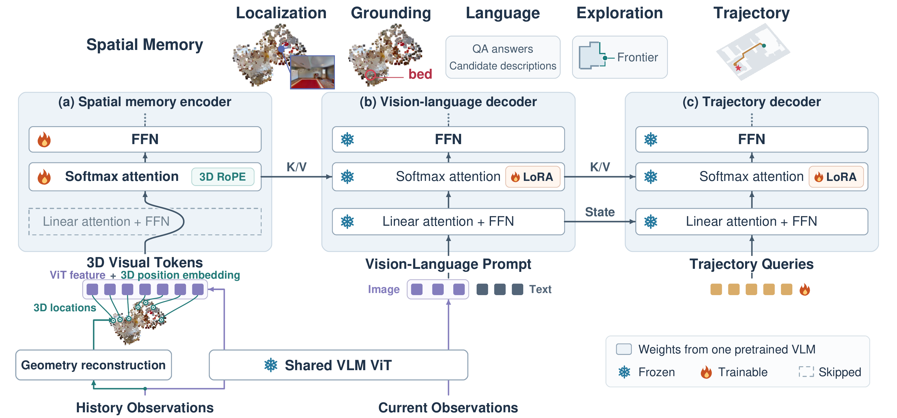
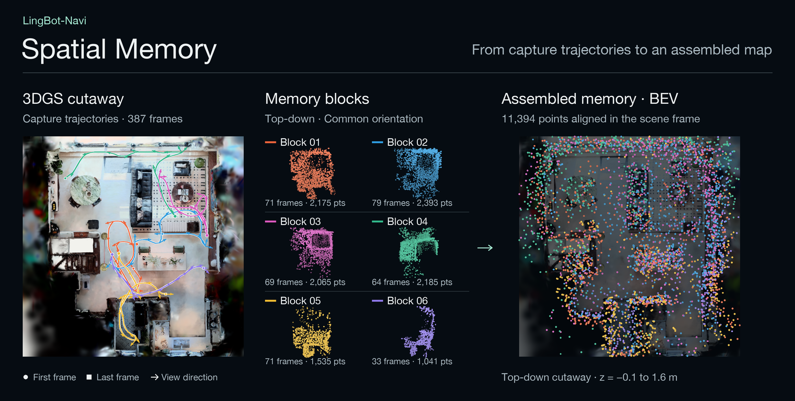
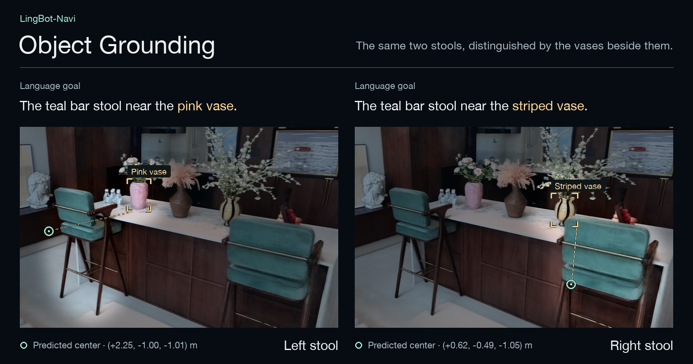
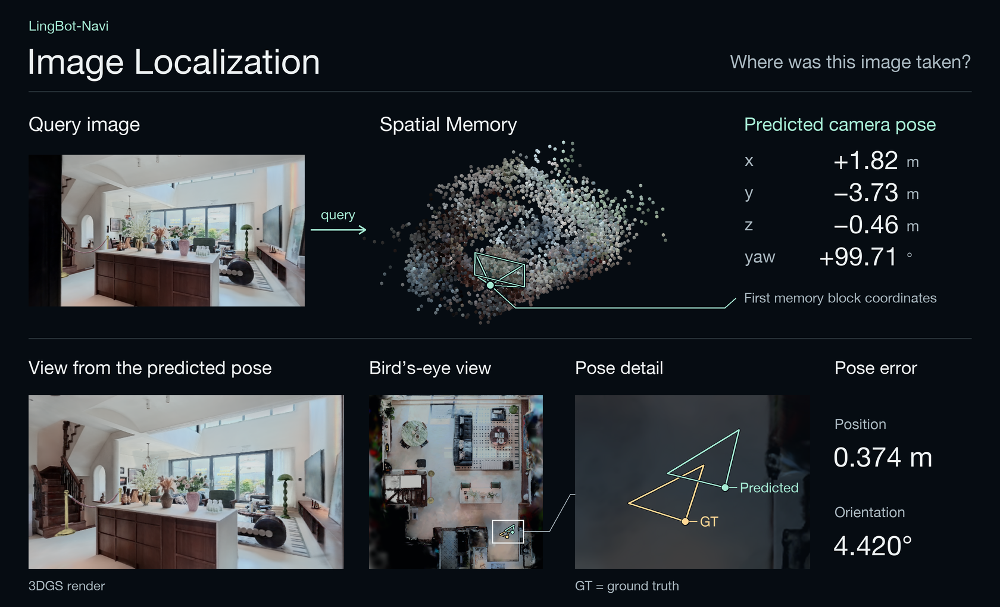
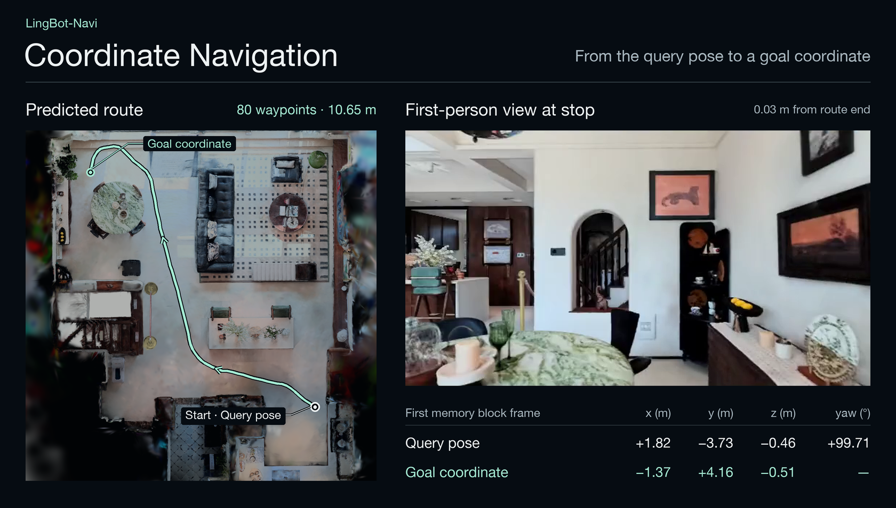
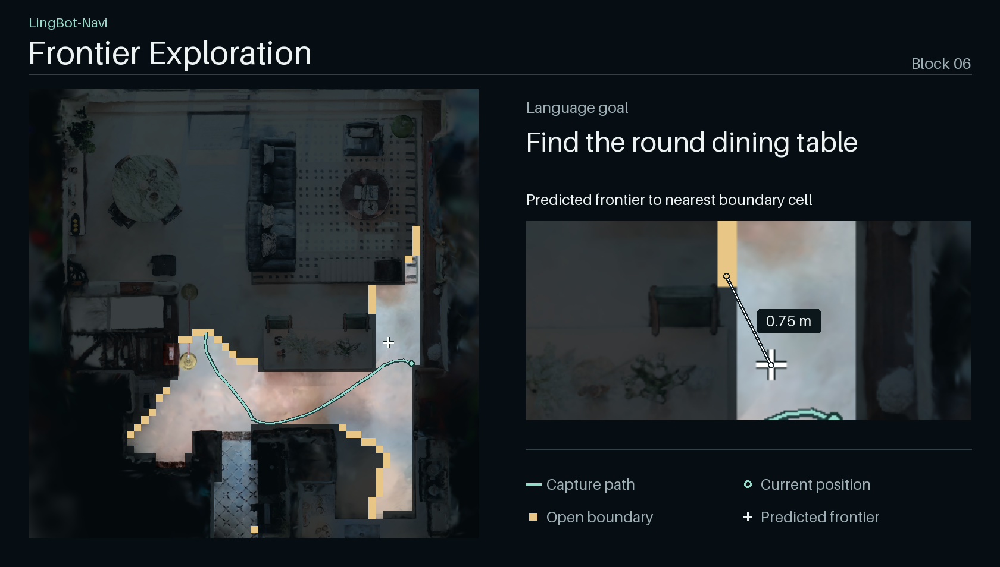

<div align="center">

<h1>LingBot-Navi：Scene‑aware Navigation with Spatial Memory</h1>

<p><a href="README.md">English</a> | <strong>简体中文</strong></p>

<p><strong>空间记忆 · 物体定位 · 图像定位 · 坐标导航</strong></p>

<p><a href="https://github.com/Robbyant/lingbot-navi"></a> <a href="#quick-start"></a> <a href="#installation"></a> <a href="https://huggingface.co/robbyant/lingbot-navi"></a> <a href="https://www.modelscope.cn/models/Robbyant/lingbot-navi"></a> <a href="https://huggingface.co/datasets/robbyant/LingBot-Navi"></a> <a href="https://www.modelscope.cn/datasets/Robbyant/LingBot-Navi"></a></p>

</div>

---

### 🧭 认识 LingBot-Navi！

**LingBot-Navi** 旨在解决机器人连续导航中的核心问题：如何利用历史观测理解新的任务，并到达当前视野之外的目标。模型通过 **Spatial Memory（空间记忆）** 关联历史场景信息、当前图像与语言指令。

- **可复用的三维记忆：** 将视觉特征锚定到重建的三维表面，以紧凑的空间 token 组织多个局部重建块中的场景信息。
- **统一的场景理解与导航：** 结合空间记忆编码器、视觉语言解码器和轨迹解码器，支持物体定位、图像定位、空间问答和三维路线预测。
- **工作场景数据与评测：** 提出基于真实工作场景重建的数据集与连续任务基准，用于研究多个导航目标之间的记忆复用。

<p align="center">
  
</p>

---

## 📑 目录

<details>
<summary>点击展开</summary>

- [更新动态](#news)
- [安装](#installation)
- [模型下载](#model-download)
- [数据集](#dataset)
- [快速开始](#quick-start)
  - [构建空间记忆](#build-spatial-memory)
  - [物体定位](#object-grounding)
  - [图像定位](#image-localization)
  - [坐标导航](#coordinate-navigation)
  - [局部规划执行](#local-route-execution)
  - [前沿探索](#frontier-exploration)
- [Benchmark（评测基准）](#benchmark)
- [许可证](#license)
- [引用](#citation)
- [致谢](#acknowledgments)

</details>

---

<a id="news"></a>

## 📰 更新动态

- **2026-11-26** — LingBot-Navi 首次公开发布，同步开放推理代码、模型权重和数据集。

<a id="installation"></a>

## ⚙️ 安装

**环境要求：** Linux x86_64、Python 3.10+ 和 NVIDIA GPU。渲染需要 CUDA 12.8 工具包及 C++ 编译器。

~~~bash
git clone https://github.com/Robbyant/lingbot-navi.git LingBot-Navi
cd LingBot-Navi
conda create -n lingbot-navi -c conda-forge python=3.10 git -y
conda activate lingbot-navi
python install.py
~~~

`python install.py` 会一并安装固定版本的 `lingbot-map` 包，供空间记忆 example 和闭环评测共用。

<a id="model-download"></a>
<a id="model-files"></a>

## 📦 模型下载

| 模型名称 | Huggingface 仓库 | ModelScope 仓库 | 描述 |
| --- | --- | --- | --- |
| LingBot-Navi | [robbyant/lingbot-navi](https://huggingface.co/robbyant/lingbot-navi) | [Robbyant/lingbot-navi](https://www.modelscope.cn/models/Robbyant/lingbot-navi) | 用于物体定位、图像定位和坐标导航的空间记忆模型。 |

<a id="dataset"></a>
<a id="dataset-download"></a>

## 🌍 数据集

| 数据集名称 | Huggingface 仓库 | ModelScope 仓库 | 描述 |
| --- | --- | --- | --- |
| LingBot-Navi | [robbyant/LingBot-Navi](https://huggingface.co/datasets/robbyant/LingBot-Navi) | [Robbyant/LingBot-Navi](https://www.modelscope.cn/datasets/Robbyant/LingBot-Navi) | 511 个重建的真实场景。 |
| LingBot-Navi-Test | [robbyant/LingBot-Navi-Test](https://huggingface.co/datasets/robbyant/LingBot-Navi-Test) | [Robbyant/LingBot-Navi-Test](https://www.modelscope.cn/datasets/Robbyant/LingBot-Navi-Test) | 36 个测试场景，均包含在 LingBot-Navi 全集中。 |

### 3DGS 渲染示例

[此示例](examples/render_3dgs.py)读取一个 3DGS PLY 场景，从指定相机位姿渲染并显示 RGB 图像：

~~~bash
python -m examples.render_3dgs \
  --ply /path/to/scene.ply \
  --pose 0 0 1.5 0 0 0
~~~

`--pose` 为 `x y z roll pitch yaw`，单位为米和度，可省略，默认 `0 0 1.5 0 0 0`。

<a id="quick-start"></a>

## 🚀 快速开始

在**仓库根目录**执行命令。下载 LingBot-Navi 权重 和 [LingBot-Map 权重](https://huggingface.co/robbyant/lingbot-map)，将数据和完整权重目录复制或软链接到以下位置；只需准备所运行功能对应的资产。测试使用的 3DGS 资产是 LingBot-Navi-Test 中的 `demo.ply`，可从 [Hugging Face](https://huggingface.co/datasets/robbyant/LingBot-Navi-Test) 或 [ModelScope](https://www.modelscope.cn/datasets/Robbyant/LingBot-Navi-Test) 下载。

将下载的整个 `lingbot-navi` 文件夹放入仓库的 `ckpts/`，保留包内目录结构。

```text
datasets/
  goat/hm3d/v1/             # GOAT task splits
  goat/scene_datasets/      # HM3D scene assets
  lingbot/                  # lingbot-navi evaluation release (manifest.json)
ckpts/
  lingbot-navi/
    navigation_transformer/
    local_planner/checkpoint.pt
  lingbot-map/
    lingbot-map.pt          # spatial-memory demo and lingbot-map1.0 evaluation
```

软链接示例（将 `/path/to/...` 替换为真实路径；也可用 `cp -a 源路径 目标路径` 复制到同一位置）：

```bash
mkdir -p datasets/goat ckpts/lingbot-map
ln -s /path/to/lingbot-navi ckpts/lingbot-navi
ln -s /path/to/lingbot-map.pt ckpts/lingbot-map/lingbot-map.pt
```

将 `LINGBOT_GS_ASSET` 设置为下载的 `demo.ply` 的路径。

```bash
export LINGBOT_GS_ASSET=/path/to/demo.ply
```

- **Demo 1：** 沿保存的六段相机轨迹渲染 3DGS 场景，构建空间记忆。
- **Demo 2–4：** 使用提供的 `memory.npz` 或自建记忆，进行物体定位、图像定位和坐标导航，可跳过 Demo 1。
- **Demo 5：** 用局部规划器执行预测轨迹并保存视频。

示例记忆由记录的六段采集轨迹重新构建（`segment_01`–`segment_06`），预处理后共 11,394 个点。各块保留独立的局部坐标系，预测结果使用首块坐标系。

下方命令将预测结果（`result.json`）及可视化保存在 `outputs/demo/` 下；重复运行时请指定新的输出目录。

<a id="build-spatial-memory"></a>

### 1. 构建空间记忆

读取 `trajectory.json` 中的相机位置、朝向、内参和分块信息，在 3DGS 场景中逐帧渲染 RGB，再由 LingBot-Map 重建各块、提取 Qwen3.5-4B 视觉特征，生成空间记忆。

示例使用原始采集轨迹的 **387 帧、六段轨迹**，各段分别包含 **71、79、69、64、71、33 帧**。左侧采集轨迹与中间的记忆块按颜色对应。右侧把六个块变换到场景坐标系，再按与左图相同的朝向和比例投影到同一张 3DGS 横切图上。横切范围为相对地面高度 −0.1 至 1.6 米。俯视图中的箭头表示相机朝向，圆点和方块分别标记每段的起点和终点。



~~~bash
python -m examples.build_spatial_memory \
  --gs-asset "$LINGBOT_GS_ASSET" \
  --output-dir "outputs/demo/spatial_memory"
~~~

生成的 `memory.npz` 可用于 Demo 2–4，将 `--memory` 指向该文件，`--scene` 指向同一输出目录中的 `scene.json`。

<a id="object-grounding"></a>

### 2. 物体定位

根据周围参照物区分同类目标：分别定位粉色花瓶旁和条纹花瓶旁的青绿色吧台椅。



将 `grounding question` 替换为目标物体的描述。

~~~bash
python -m examples.demo \
  --task grounding --question "grounding question" \
  --gs-asset "$LINGBOT_GS_ASSET" \
  --output-dir "outputs/demo/grounding"
~~~

<a id="image-localization"></a>

### 3. 图像定位

用 `query.png` 查询 Spatial Memory，得到相机的位置和朝向。示例图像位于 BEV 右下方通道，朝向左上方；相机参数保存在 `scene.json` 中。

<details>
<summary>查询图像预处理</summary>

示例图像以 1080×640、水平视场角 90° 渲染，经 Lanczos 等比例缩放至长边 640，再居中裁剪为 640×352，以对齐到 32 的倍数。相机内参随缩放和裁剪同步调整。使用自己的图像时，请在 `scene.json` 中提供对应内参。

</details>

~~~bash
python -m examples.demo \
  --task localization --question "Where am I?" \
  --gs-asset "$LINGBOT_GS_ASSET" \
  --output-dir "outputs/demo/localization"
~~~

输出示例：

~~~text
The image pose is <|3d_pose|> at (+1.82,-3.73,-0.46),
quaternion_xyzw=(-0.0012,+0.0019,+0.7644,+0.6447).<|im_end|>
~~~



相对于查询相机位姿，**位置误差为 0.374 米，朝向误差为 4.420°**。

<a id="coordinate-navigation"></a>

### 4. 坐标导航

以 Demo 3 预测的位姿为起点，导航至首块坐标系中的 `[-1.366958, 4.164281, -0.513988]` 米处。终点位于圆桌左上方的空地。

~~~bash
python -m examples.demo \
  --task coordinate --question "Navigate to the goal" \
  --localization-result "outputs/demo/localization/result.json" \
  --goal-xyz -1.366958 4.164281 -0.513988 \
  --gs-asset "$LINGBOT_GS_ASSET" \
  --output-dir "outputs/demo/navigation"
~~~

左侧为预测路线的俯视图，右侧为停止时的第一视角示意。使用随仓记忆运行时，Demo 4 预测 **80 个路径点**，Demo 5 停止时距路线末端 0.03 米。



本示例展示离线轨迹预测。

<a id="local-route-execution"></a>

### 5. 局部规划执行

将 Demo 4 预测的同一条轨迹交给局部规划器，起始相机和终点均保持一致。执行时从 3DGS 场景中保存的查询相机位姿出发。每一步，规划器根据当前渲染图像、仿真位姿和路线决定转向或前进，执行动作后再渲染下一帧。

https://github.com/user-attachments/assets/da9c73f2-d969-4ab1-83d3-1c27b50e7eb7

~~~bash

python -m examples.demo execute-navigation \
  --route-result "outputs/demo/navigation/result.json" \
  --gs-asset "$LINGBOT_GS_ASSET" \
  --output-dir "outputs/demo/execution"
~~~

`execution.mp4` 左侧显示第一视角，右侧俯视图对比预测路线和实际执行轨迹。`execution.json` 记录每步动作、仿真位姿和停止原因。这个 3DGS 示例采用运动学更新，未接入碰撞物理。

<a id="frontier-exploration"></a>

### 6. 前沿探索



只给模型第六块记忆，在这段采集轨迹的最后一帧询问圆餐桌。示例先对这一帧做图像定位，使用估计的位姿将预测投到俯视图。模型先做 grounding，回答未找到时，再用同一块记忆预测下一处 frontier。

```bash
python -m examples.demo partial-exploration --block segment_06 --question "the round dining table" \
  --gs-asset "$LINGBOT_GS_ASSET" --output-dir outputs/demo/exploration
```

`exploration.png` 展示保留记忆块的覆盖范围和采集轨迹。金色格子标出与未知可通行区域相邻的边界，白色十字标出模型预测的前沿点。右侧放大图显示预测点到最近金色格子中心的水平距离。问答和预测坐标保存在 `result.json` 中。

<a id="benchmark"></a>

## 🏁 Benchmark（评测基准）

### 1. 环境和依赖安装

在仓库根目录执行以下命令。需要 Linux、NVIDIA GPU、Python 3.10、CUDA 12.8 Toolkit 和 C++ 编译器。

评测复用前文安装步骤创建的 `lingbot-navi` 环境。`python install.py --habitat-sim` 会通过 pip 从固定上游源码构建并安装无窗口版 Habitat-Sim 0.3.3。首次构建需要 Git、CMake、C++ 编译器及 OpenGL/EGL 开发头文件，可能耗时数分钟。Ubuntu/Debian 可执行 `sudo apt-get install build-essential git pkg-config libgl1-mesa-dev libegl1-mesa-dev` 安装系统依赖；脚本会安装 CMake。requirements 中的 Pillow 固定为兼容 Habitat-Sim 的 10.4.0。

```bash
conda activate lingbot-navi
python install.py --habitat-sim

mkdir -p third_party
git clone https://github.com/Ram81/goat-bench.git third_party/goat-bench
git -C third_party/goat-bench checkout 74c41d19d4a4c3608d1575b512087b5a529aee0e
python -m close_loop_test.goat.prepare_dependency third_party/goat-bench --habitat-modern
```

`python install.py` 会在依赖安装完成后自动编译并检查 gsplat CUDA 扩展。请在每台评测机器上执行安装，编译失败时安装会报错退出。

安装 [Basis Universal](https://github.com/BinomialLLC/basis_universal)，将 `basisu` 加入 `PATH`，或通过 `BASISU_PATH` 指定可执行文件路径。

评测仅需额外准备以下资产：

| 资产 | 使用范围 | 获取方式 |
| --- | --- | --- |
| GOAT-Bench 任务和 HM3D 场景 | GOAT | 按 `third_party/goat-bench/README.md` 下载 |
| lingbot-navi 静态评测数据集 | lingbot-navi | [数据集](#dataset)；使用包含多高度可见性标注的 release-v1 静态评测包 |

将评测数据复制或软链接到以下默认位置，无需额外设置路径环境变量：

```bash
mkdir -p datasets/goat/hm3d
ln -s /path/to/datasets/goat_bench/hm3d/v1 datasets/goat/hm3d/v1
ln -s /path/to/scene_datasets datasets/goat/scene_datasets
ln -s /path/to/lingbot-eval-dataset datasets/lingbot
```

### 2. 启动评测

激活 `lingbot-navi` 环境，修改对应数据集的配置文件后运行：

```bash
python -m close_loop_test.run --config close_loop_test/config/exp_config_goat.json
python -m close_loop_test.run --config close_loop_test/config/exp_config_lingbot.json
```

结果保存到 `outputs/` 下的新目录，也可用 `--output` 指定。批次结束自动生成 `summary.json`，保存实际配置的 `manifest.json`、退出状态 `subset_status.json`、逐例 `result.json` 和日志。每例的 `events.jsonl` 保留任务边界及动作前的 agent 位置、旋转四元数（xyzw，Habitat Y-up），可用于轨迹追溯。模型输入图片、TF 帧和空间记忆只在该 episode 的临时目录中使用，模型关闭后清理。失败或缺失结果会明确标记，命令返回非零退出码。需要独立复算时使用：

```bash
python -m close_loop_test.summarize --expected-episodes 36 outputs/你的实验目录/*/episode-0/result.json
```

### 3. 参考评测结果

SR（成功率）和 SPL（按路径长度加权的成功率）按 episode 等权平均。

以下为 LingBot-Navi 发布版模型在 **H20-3E GPU** 上的评测结果。评测使用 10% 子集，每个场景取索引为 0 的 episode，每组配置共 36 个 episode。

| 配置 | Episodes | 初始化探索步数 | SR | SPL |
| --- | --- | --- | --- | --- |
| subset goat | 36 | 200 | 68.26% | 38.26% |
| subset goat+lingbot-map1.0 | 36 | 200 | 61.12% | 33.00% |
| subset lingbot-navi | 36 | 1000 | 48.75% | 26.22% |
| subset lingbot-navi+lingbot-map1.0 | 36 | 1000 | 41.94% | 23.50% |

<a id="license"></a>

## 📜 许可证

代码许可证见 [LICENSE](LICENSE)，第三方归属声明见 [NOTICE](NOTICE)。第三方许可证原文收录于 [licenses/](licenses/)。

<a id="citation"></a>

## 📖 引用

```bibtex
@article{lingbot-navi,
  title={Scene-aware Navigation with Spatial Memory},
  author={Huanhang Hu and Xiao Li and Lingyuan Yang and Tong Wang and Tianlong Sun and
          Jie Ding and Bo Chen and Ge Mu and Zhenhang Guo and Yuzheng Liu and Jiawei Wang and
          Zixuan Wang and Zihan Wang and Shizhe Zang and Xing Zhu and Yujun Shen and
          Yangyan Li and Xinghe Li},
  url={https://github.com/Robbyant/lingbot-navi/blob/main/tech_report/Scene-aware%20Navigation%20with%20Spatial%20Memory.pdf},
  year={2026}
}
```

<a id="acknowledgments"></a>

## ✨ 致谢

本项目基于以下开源工作构建，感谢各项目的贡献：

- **[Qwen3.5-4B](https://huggingface.co/Qwen/Qwen3.5-4B)**：语言与视觉骨干网络。
- **[Pi3](https://github.com/yyfz/Pi3)**：位姿头实现的改编来源。
- **[LingBot-Map](https://github.com/Robbyant/lingbot-map)**：空间记忆构建中的流式几何重建。
- **[gsplat](https://github.com/nerfstudio-project/gsplat)**：高斯光栅化。
- **[Brush](https://github.com/ArthurBrussee/brush)**：我们的 3DGS 渲染器参考了 Brush 的球谐颜色计算方式。
